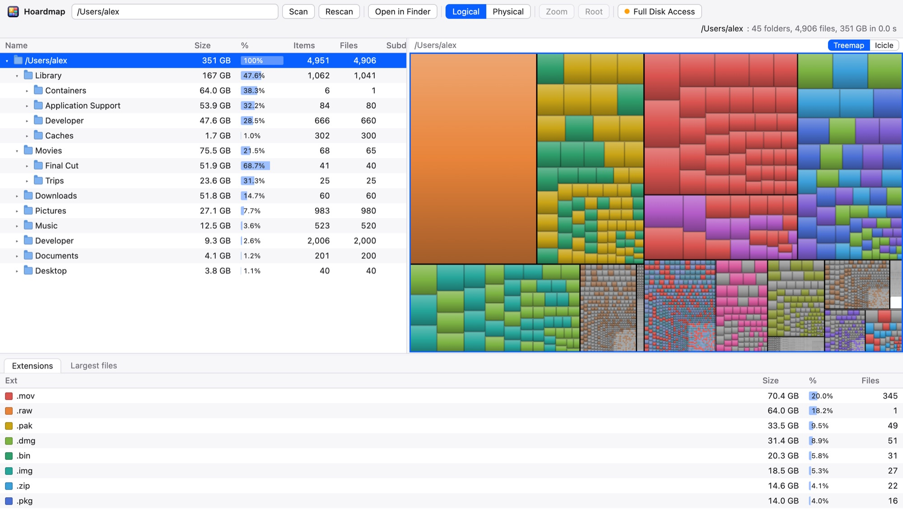

# Hoardmap

[](https://github.com/abhishekkundu25/hoardmap/actions/workflows/ci.yml)
[](https://github.com/abhishekkundu25/hoardmap/releases/latest)


**[Download Hoardmap.dmg](https://github.com/abhishekkundu25/hoardmap/releases/latest/download/Hoardmap.dmg)** · [Website](https://abhishekkundu25.github.io/hoardmap/)

<picture>
  <source media="(prefers-color-scheme: dark)" srcset="site/img/treemap-dark.jpg">
  
</picture>

Hoardmap is WinDirStat for the Mac. It scans a folder and shows where the bytes are
in three linked views: a directory list, a treemap or icicle, and an extension list.
It comes two ways: a command that serves the page to your browser, and a native Mac
app that shows the same page in its own window. Both listen on 127.0.0.1 only. From
the page you can open any folder or file in Finder. That is the only thing it can do
to your files; it never deletes, moves or renames anything.

## Download

The [Releases](../../releases) page has, for Apple silicon and Intel Macs on macOS 11
or later:

- `Hoardmap.dmg`: open it and drag Hoardmap onto Applications.
- `Hoardmap.zip`: the same app, zipped.
- `hoardmap-macos.tar.gz`: the `hoardmap` terminal command.

The newest DMG is always at
`https://github.com/abhishekkundu25/hoardmap/releases/latest/download/Hoardmap.dmg`,
which is what the website links to.

The app is not notarized by Apple, so macOS blocks the first launch. Press Done, then
open System Settings, Privacy & Security, and press Open Anyway next to Hoardmap. Or
run `xattr -dr com.apple.quarantine /Applications/Hoardmap.app` once.

## Build from source

You need macOS and Rust 1.85 or newer. Clone the repository and run:

```sh
cargo install --path .
```

This builds the `hoardmap` binary and puts it in `~/.cargo/bin`.

## Usage

```sh
hoardmap
```

Scans your home folder and opens the page in your default browser. The scan starts at
once and the page shows progress while it runs.

```sh
hoardmap /some/folder
```

Scans that folder instead. You can also type another path in the page and press Scan.

Options:

```
Usage: hoardmap [PATH] [--port N] [--no-open] [--linger SECS] [--help]

Scans PATH (default: your home folder) and serves the result on 127.0.0.1.

  --port N        listen on port N (default: one the OS picks)
  --no-open       do not launch the browser
  --linger SECS   exit this many seconds after the last tab closes (default 10)
  -h, --help      show this help
```

With `--no-open` the first line printed to stdout is the URL to visit, in the form
`Listening on http://127.0.0.1:PORT/`. `--linger` accepts fractions of a second.

## The Mac app

The app is the same server and page in a native window, with the usual menus. Build it
and copy it to `~/Applications`:

```sh
tools/bundle-app.sh --install
```

Without `--install` the bundle is left at `target/Hoardmap.app`. Open it from Finder,
Launchpad or with `open ~/Applications/Hoardmap.app`. Closing the window quits it.

The first time it starts, the app shows a start screen before it scans anything. The
screen says what hoardmap does and does not do, and covers Full Disk Access:

- Whether the app has access, read from a file only it can open.
- Open Settings, which goes straight to Privacy & Security, Full Disk Access.
- Show hoardmap in Finder, so you can drag the app into that list.
- Relaunch hoardmap, because macOS applies the switch to a new process.
- Continue without access, which scans everything macOS allows. Without access, macOS
  may ask once about Desktop, Documents, Downloads and other protected folders as the
  scan reaches them; the scan waits at that folder until you answer.

Access is optional. The screen comes back at each launch until access is on, unless you
tick "Don't show this at launch". The Full Disk Access button in the toolbar opens it
at any time, with a green dot when access is on and an orange one when it is off. In the
browser version the same button explains how to grant access to your terminal instead.

macOS ties Full Disk Access to the app's signature. The bundle script signs ad hoc,
which gives each build a new signature, so after a rebuild you may need to turn the
switch off and on again.

## The views

The top bar holds the path field with Scan and Rescan, an Open in Finder button, the
Logical and Physical size toggle, the Zoom and Root buttons for the treemap, and a
status line with the scanned path, folder and file counts, total bytes and scan time.
Sizes start in Physical, what the files take on disk; the status total follows the toggle.
Press Rescan after clearing files in Finder to see the new figures.

### Directory list

The left pane is an expandable tree, sorted largest first. The columns are Name, Size,
%, Items, Files, Subdirs and Last change. The % column shows the share of the parent
with a bar behind the number. Sizes are in human units; hover a size for the exact
byte count. Symlinks and hard links are marked as such, so a 0 byte entry is not a
mystery. Click a row to select it, click the triangle to expand or collapse it, and
double-click a row to open it in Finder.

Keyboard, when the list has focus:

- Up and Down move the selection.
- Right expands a folder, or moves into it when it is already expanded.
- Left collapses a folder, or moves to the parent when it is already collapsed.
- Enter opens the selection in Finder.
- Home and End jump to the first and last row.

### Treemap

The right pane draws every file as a rectangle whose area is proportional to its size.
Colour is by extension: the fifteen extensions with the most bytes get a colour each,
every other extension is grey, and folders too small to draw their contents are a
darker grey. The layout is recomputed by the server whenever the pane is resized.

- Hover a rectangle to see its path and size.
- Click a rectangle to select that file in the directory list. The list expands the
  file's ancestors and scrolls to it.
- Double-click a rectangle to open it in Finder.
- Selecting a folder in the list outlines its region in the treemap.
- Zoom redraws the treemap with the selected folder as its root. Root goes back to the
  scanned folder. The caption above the treemap names the current root.

### Icicle

The Treemap and Icicle switch above the right pane changes the picture. The icicle
draws one row per folder level: the current root across the top, and each folder or
file under its parent with a width proportional to its bytes, largest on the left.
Bars wide enough for text show the name and size. It shows where a large file sits in
the hierarchy, which the treemap hides. Hover, click, double-click, Zoom, Root and the
extension highlight work the same as in the treemap. Rows stay at least 18 pixels tall,
so a very deep path is cut off at the bottom; zoom into a folder to see further down.
The page remembers the view you picked.

### Extension list

The Extensions tab at the bottom is the treemap legend. For each extension under the
current treemap root it shows the colour, the bytes, the share and the file count,
largest first. Files without an extension are one row. Click an extension to highlight
its rectangles in the treemap and dim all others. Click it again, or press Escape, to
clear the highlight.

### Largest files

The Largest files tab lists the biggest files under the current treemap root with their
full paths. Click a row to select the file in the directory list; double-click it to
open it in Finder.

### Logical and Physical

Logical is the number of bytes a file contains. Physical is the number of bytes
allocated for it on disk. The two differ for sparse files and for APFS clones. A Docker
disk image such as `Docker.raw` can report 64 GB logical while only a few GB are
allocated. Physical is the default because it is what clearing a file gives back;
switch to Logical to see file contents. Every view, and the total in the status line,
follows the toggle.

Hard links are counted once. A file reached again through a second link shows 0 bytes
and is marked as a hard link, so totals match what the disk says. The scan stays on the
volume of the folder you scanned, so scanning `/` does not count `/Volumes` or count
the Data volume twice through firmlinks. Symlinks are not followed.

### Unreadable folders

Folders the scan may not read do not stop it. They are counted, and the status line
shows a button such as `3 unreadable`. Click it for the list of paths and errors. The
totals do not include what is behind those folders.

### Full Disk Access

On a real home folder every unreadable entry reads `Operation not permitted`. That is
macOS privacy protection (TCC), not file permissions. It covers app sandboxes under
`Library/Containers` and `Library/Group Containers`, the Photos Library, Safari, Mail
data and the Trash. hoardmap inherits its access from the app that launched it, and
nothing in the code can bypass that.

To scan those folders, give the terminal that launches hoardmap Full Disk Access:

1. Open System Settings > Privacy & Security > Full Disk Access. This command opens
   that pane directly:

   ```sh
   open "x-apple.systempreferences:com.apple.preference.security?Privacy_AllFiles"
   ```

2. Add Terminal, or the terminal you use (iTerm, Warp, the VS Code terminal), and turn
   it on.
3. Quit and reopen the terminal.
4. Run hoardmap again, or press Rescan.

The unreadable button in the page lists exactly which folders were skipped, so you can
check the result.

## How it opens things

Double-clicking, pressing Enter, or pressing Open in Finder sends the selected node to
the server. For a file or symlink the server runs `open -R <path>`, which shows the
file selected in a Finder window. For a folder it runs `open <path>`, which opens that
folder in Finder. The path comes from the server's own scanned tree, never from the
request. That is the only action the server can take.

## What it never does

hoardmap does not delete, move, rename or trash files, and it has no button, key or
API endpoint that could. The test `source_never_deletes_moves_or_renames` in
`tests/api.rs` reads every source file and fails if a call such as `remove_file`,
`remove_dir`, `rename` or `trash` appears. Clearing space is done in Finder, by hand,
after looking.

## How it scans

On macOS each folder is listed with `getattrlistbulk`, which returns names, types,
sizes and allocated blocks for a batch of entries in one system call. Elsewhere, and
on a Mac with `HOARDMAP_SCANNER=portable`, each folder is read with `read_dir` and
each entry with `lstat`. Both build the same tree. Subfolders are read in parallel on
every core.

To time both on a folder of your own and check they agree:

```sh
cargo run --release --example scan_bench -- ~ 5
```

On a home folder of about 900,000 files with a warm cache, the bulk listing took a
median of 2.0 s against 2.6 s; on a 180,000 file folder, 0.13 s against 0.21 s. On a
folder that apps are writing to, a few entries can differ between the two scans
because they changed in between.

## Privacy and safety

- The server binds to 127.0.0.1 only. Nothing on your network can reach it.
- It makes no network requests of its own.
- The page loads no external scripts, fonts or styles. Everything is embedded in the
  binary and works offline.
- Every request must carry a `Host` header naming `127.0.0.1` or `localhost` on the
  bound port. Anything else is refused with 403, which defeats DNS rebinding.
- POST requests must have `Content-Type: application/json` and a JSON body. A page on
  another website cannot send such a request without a CORS preflight, and the server
  never answers a preflight with CORS headers. So another site cannot start a scan or
  open a folder.
- The path for `open` is looked up in the scanned tree by node id. A request can never
  name a path of its own.

## Exit rule

The server exits by itself. It counts connected browser tabs through an event stream.
When the last tab closes, a timer of `--linger` seconds starts, 10 by default. If no
tab reconnects before it fires, the process exits with status 0. A reload within the
linger period keeps it alive. Before the first tab ever connects the server waits
indefinitely, so a slow browser launch does not lose it.

While you look at the page the server does nothing. Its threads block until a request
or a scan event arrives. A test in `tests/resources.rs` measures this: an idle server
with a tab connected must use under 0.1 s of CPU in 2 s.

## Development

GitHub Actions runs the format check, both lint passes and the tests on every push to
`main` and every pull request (`.github/workflows/ci.yml`).

To release, set `version` in `Cargo.toml`, move the Unreleased notes in `CHANGELOG.md`
under that version, commit, then push a matching tag:

```sh
git tag v0.2.0 && git push origin v0.2.0
```

`.github/workflows/release.yml` checks the tag against `Cargo.toml`, runs the tests,
builds the downloads with `tools/release.sh`, publishes them as a GitHub release with
`.github/release-notes.md`, and then publishes the website. `tools/release.sh` also runs locally and leaves the
files in `target/dist`; it needs the `x86_64-apple-darwin` Rust target.
The DMG opens on a window with a background that says to drag the app onto the
Applications link beside it; the script lays it out by driving Finder, which macOS may
ask you to allow once. The background is `tools/dmg-background.html`, rendered with the
app icon by `tools/make-images.sh` (needs Google Chrome).

The website is `site/index.html`, plain HTML with its screenshots in `site/img`.
The release workflow publishes it to GitHub Pages after the downloads, through
`.github/workflows/pages.yml`, which adds the logo and the version. The site and the
downloads therefore change only with a release; edits to `site/` on `main` wait for the
next tag. To redeploy the current release by hand: `gh workflow run pages.yml --ref vX.Y.Z`.

Build and check, each from the repository root:

```sh
cargo build
cargo fmt --check
cargo clippy --all-targets -- -D warnings
timeout 120 cargo test                        # unit and integration tests
timeout 120 cargo test --test resources       # idle CPU and exit checks, one file
```

The page files under `web/` are embedded with `include_str!`, so a change to the page
needs a rebuild. There is no frontend build step and no JavaScript dependency.

Integration tests start the debug binary with `--no-open --linger 1` and put a stub
`open` on `PATH`, so no test opens your browser or Finder.

- `tests/resources.rs`: the listening line, static files and their content types, the
  idle CPU budget, exit after the last tab closes, reload within linger, waiting for the
  first tab, and that `--no-open` runs nothing.
- `tests/scan.rs`: the scanner on a fixture tree with known sizes, a hard-linked pair, a
  symlink, nested empty folders and an unreadable folder: totals, order, hard-link
  accounting, physical size, mtime roll-up, error count and progress.
- `tests/treemap.rs`: rectangles never overlap, stay inside the viewport and inside
  their parent, sub-pixel nodes are dropped or collapsed, colours rank the top fifteen
  extensions, extension and largest-file statistics, and a 200,000 file layout is fast.
- `tests/api.rs`: every endpoint end to end against the fixture, the 400, 404, 409, 413
  and 415 paths, the icicle's rows and nesting, the `Host` check, that `/api/open` runs `open -R` for a file and bare
  `open` for a folder, and the no-delete source check.

The native app is `src/bin/hoardmap-app.rs`, built with `--features app` (tao, wry
and muda). The plain `cargo build` leaves those out.

The JSON endpoints are `GET /api/status`, `GET /api/events` (server-sent events),
`GET /api/node/{id}`, `GET /api/treemap`, `GET /api/icicle`, `GET /api/extensions`, `GET /api/largest`,
`GET /api/errors`, `GET /api/access`, `POST /api/scan`, `POST /api/open` and
`POST /api/access/settings`; the app adds `POST /api/access/reveal` and
`POST /api/relaunch`. Their shapes are in the spec.

The spec is `docs/specs/hoardmap.md`. The build tickets, with the departures from the
plan, are in `docs/tickets/hoardmap/`. `AGENTS.md` is the short map of the code.

## Credits

- The treemap layout is the squarified treemap of Bruls, Huizing and van Wijk.
- The three linked views, the extension legend and the logical and physical sizes
  follow WinDirStat.
